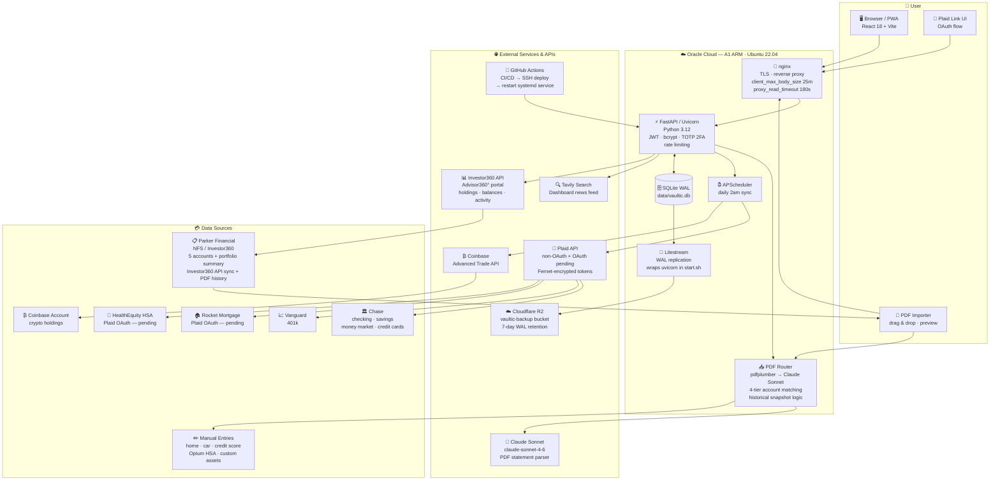

# Vaultic

**Your personal net worth dashboard.**

Vaultic is a self-hosted personal finance dashboard that aggregates all your accounts in one place — bank accounts, investments, retirement, crypto, mortgage, and manually tracked assets — on one dashboard with net worth history, allocation, market data and news.

> In November 2026 (#82) Vaultic was trimmed to the dashboard and the syncs behind it. Sage, Budget, Fund Financials, Taxes, Paystubs, the Document Vault and the Calendar were removed. The full app is preserved at git tag `full-app-2026-11`.

---

## Table of Contents

1. [Overview](#overview)
2. [Tech Stack](#tech-stack)
3. [Project Structure](#project-structure)
4. [Architecture](#architecture)
5. [Database Schema](#database-schema)
6. [API Reference](#api-reference)
7. [Security](#security)
8. [Development Process](#development-process)
9. [Local Development Setup](#local-development-setup)
10. [Environment Variables](#environment-variables)
11. [Deployment](#deployment)
12. [Backups & Disaster Recovery](#backups--disaster-recovery)
13. [CI/CD Pipeline](#cicd-pipeline)
14. [Running Tests](#running-tests)
15. [Test Coverage](#test-coverage)
16. [Costs](#costs)
17. [Roadmap](#roadmap)

---

## Overview

Vaultic is a **personal-use, self-hosted** application. It is not a commercial SaaS product. It runs on a single Oracle Cloud A1 (always-free) instance and is accessed from any device via browser.

### What It Does

- **Unified dashboard** — net worth, all accounts, credit score, home value, car value, allocation, market summary and news on one screen
- **Plaid integration** — connect Chase, Vanguard, Voya, Insperity, Robinhood, Rocket Mortgage, and any other Plaid-supported institution
- **Investor360 API sync** — Parker Financial accounts (NFS/Commonwealth custodian) synced via Investor360 API with holdings, balances, performance, and activity data; historical PDF imports backfilled into the same account_balances/i360_holdings tables
- **PDF import** — parse NFS account statements for historical data; NFS statements use a free deterministic regex parser (no AI cost); other PDFs fall back to Claude Sonnet extraction
- **Manual entries** — home value, car value, credit score, and any other asset or liability
- **Net worth history** — daily snapshots, historical charts
- **2FA (TOTP)** — Google Authenticator / Authy enrollment
- **Security logging** — verbose audit log of every login, API call and sync event, with live tail viewer in the UI
- **Continuous backup** — Litestream streams every SQLite WAL change to Cloudflare R2 within ~1 second; 7-day retention; one-command restore

---

## Tech Stack

| Layer | Technology |
|---|---|
| **Backend** | Python 3.12, FastAPI, Uvicorn |
| **Database** | SQLite (WAL mode) |
| **Frontend** | React 18, Vite |
| **Account linking** | Plaid Python SDK + Plaid Link (React) |
| **News search** | Tavily API (Dashboard news feed) |
| **PDF parsing** | pdfplumber + deterministic NFS regex parser ($0 cost) + Claude Sonnet fallback |
| **Auth** | JWT (PyJWT) + bcrypt password hashing |
| **2FA** | TOTP via pyotp + QR code via qrcode |
| **Encryption** | Fernet symmetric encryption (cryptography library) for Plaid tokens at rest |
| **Scheduling** | APScheduler (daily 2am sync) |
| **Backup** | Litestream → Cloudflare R2 (continuous WAL replication, 7-day retention) |
| **Hosting** | Oracle Cloud A1 (always-free ARM instance) |
| **CI/CD** | GitHub Actions → SSH deploy |

---

## Project Structure

```
vaultic/
├── CLAUDE.md                # Coding standards (for AI and human contributors)
├── api/
│   ├── main.py              # FastAPI app, middleware, router registration
│   ├── database.py          # SQLite schema, migrations, connection context manager
│   ├── auth.py              # JWT, bcrypt, TOTP (pyotp), user management
│   ├── dependencies.py      # get_current_user, get_client_ip FastAPI deps
│   ├── encryption.py        # Fernet encrypt/decrypt for Plaid access tokens
│   ├── security_log.py      # Audit logger: logins, API calls, syncs
│   ├── coinbase_sync.py     # Coinbase Advanced Trade API: CDP JWT auth, fetch/store crypto balances
│   ├── sync.py              # Plaid transaction sync (cursor-based), net worth snapshots
│   ├── rate_limit.py        # In-memory sliding window: 5 manual syncs/5min
│   ├── investor360_client.py # Investor360 API client for Parker Financial accounts
│   └── routers/
│       ├── auth.py          # /api/auth/* — login, 2FA, users, password, security log
│       ├── plaid.py         # /api/plaid/* — link token, exchange, sync, items
│       ├── accounts.py      # /api/accounts/* — list, balances, transactions, rename
│       ├── net_worth.py     # /api/net-worth/* — latest snapshot, history
│       ├── manual.py        # /api/manual/* — CRUD for manual asset entries + holdings
│       ├── crypto.py        # /api/crypto/* — Coinbase account data
│       ├── market.py        # /api/market/* — market rates
│       ├── push.py          # /api/push/* — push notification subscriptions
│       ├── investor360.py   # /api/investor360/* — Investor360 sync, snapshot migration
│       ├── ticker_feed.py   # /api/ticker-feed/* — personalized price quotes, financial news
│       ├── crypto_gains.py  # /api/crypto/* — FIFO capital gains, trade sync, lots
│       ├── pdf.py           # /api/pdf/* — PDF ingestion (Sonnet fallback), 4-tier matching
│       └── pdf_nfs.py       # /api/pdf/nfs — deterministic NFS/Commonwealth parser ($0 cost)
├── ui/
│   ├── public/
│   │   └── favicon.png      # Tab icon + sidebar logo
│   ├── src/
│   │   ├── App.jsx          # Shell: sidebar nav, routes, auth gate
│   │   ├── App.css          # Global CSS variables, layout, utility classes
│   │   ├── api.js           # All API calls (apiFetch wrapper with JWT + 401 handling)
│   │   ├── pages/
│   │   │   ├── Login.jsx        # Two-step login: credentials → 2FA code
│   │   │   ├── Dashboard.jsx    # Master view: net worth, accounts, charts
│   │   │   ├── Accounts.jsx     # Account list with balance history charts
│   │   │   ├── Transactions.jsx # Transaction browser
│   │   │   ├── Import.jsx       # CSV/PDF import
│   │   │   └── Settings.jsx     # Password, 2FA, user management, security log
│   │   └── components/
│   │       ├── NetWorthChart.jsx
│   │       ├── PlaidLink.jsx
│   │       ├── dashboard/       # 5 sub-components (PortfolioPerformance, I360SyncModal, etc.)
│   │       └── accounts/        # Investor360, Insperity and Voya account cards
│   ├── tests/e2e/
│   │   ├── helpers.js       # Shared mock API setup for all E2E tests
│   │   ├── auth.spec.js     # Login, wrong password, 2FA, logout
│   │   ├── dashboard.spec.js # Net worth, accounts, navigation
│   │   └── accounts.spec.js # Insperity detail card, account numbers, Plaid reconnect
│   ├── index.html
│   ├── package.json
│   └── vite.config.js
├── tests/                   # 450+ unit tests (one test_*.py per router)
│   ├── conftest.py          # In-memory SQLite test DB, TestClient, auth fixtures
│   ├── test_auth.py         # Auth, login, JWT, health
│   ├── test_accounts.py     # Accounts, net worth, manual entries
│   ├── test_account_numbers.py # Account number migration, unique indexes, I360 migrations
│   ├── test_2fa.py          # TOTP setup, confirm, verify, disable
│   ├── test_users.py        # User CRUD, admin endpoints, security log
│   ├── test_transactions.py # Transaction queries, balance history
│   ├── test_pdf.py          # PDF ingestion, 4-tier matching, historical detection
│   ├── test_pdf_nfs.py      # NFS deterministic parser, masked account rejection
│   ├── test_investor360.py  # I360 sync, account mapping
│   ├── test_crypto_gains.py # FIFO lot matching, trade sync, gains calculation
│   ├── test_auth_refresh.py # Refresh tokens, mobile sessions
│   ├── test_plaid.py        # Plaid link, token exchange
│   ├── test_ticker_feed.py  # Ticker quotes, news feed
│   └── test_rate_limit.py   # Sliding window rate limiting
├── data/                    # Created at runtime (gitignored)
│   └── vaultic.db           # SQLite database
├── .github/
│   └── workflows/
│       └── deploy.yml       # GitHub Actions: test → deploy on push to main
├── .env                     # Local secrets (never committed)
├── .env.example             # Template for all required environment variables
├── requirements.txt
└── pytest.ini
```

---

## Architecture

### System Architecture Diagram



### Request Flow

```
Browser → Vite dev server (port 5173) → proxy → FastAPI (port 8000)
                                    OR
Browser → Nginx (production) → static files (Vite build) + proxy /api/* → FastAPI
```

### Authentication Flow

```
POST /api/auth/login
  → bcrypt verify password
  → if 2FA enabled: return {requires_2fa: true}
  → frontend shows 6-digit TOTP input
  → POST /api/auth/verify-2fa → verify pyotp.TOTP code
  → return JWT (24hr expiry by default)

Every protected request:
  → Authorization: Bearer <jwt>
  → get_current_user dependency decodes + validates JWT
  → 401 on failure → frontend clears token + fires auth:logout event
```

### Plaid Data Flow

```
1. PlaidLink (React) → createLinkToken → /api/plaid/link-token
2. User completes Plaid Link UI (OAuth or credential-based)
3. exchangeToken → /api/plaid/exchange → stores encrypted access token in plaid_items
4. triggerSync → /api/plaid/sync → sync.sync_all()
   → for each plaid_item:
     → fetch accounts + balances → upsert into accounts + account_balances
     → cursor-based transaction sync → upsert into transactions
   → compute net worth snapshot → insert into net_worth_snapshots
5. APScheduler runs sync_all() daily at 2am
```

### PDF Import Flow

```
User drags PDF → /api/pdf/ingest (multipart, 20MB limit, 30 pages max)
  → pdfplumber extracts text from all pages (up to 30,000 chars)
  → Claude Sonnet parse prompt: extract per-account entries with:
      - name, category (invested/liquid/etc), value, notes
      - activity_summary (beginning balance, net change, TWR %, date range, YTD fields)
      - holdings[] (exact names, ticker, asset_class, shares, price, value, cost, gain/loss)
      - activity[] (individual transactions: buy, sell, dividend, reinvestment, fee, transfer)
  → if response truncated (max_tokens): _salvage_json() recovers all complete objects
  → return parsed entries to frontend for review
User reviews/edits entries → clicks Save → /api/pdf/save
  → 4-tier account matching (account_number → institution+holder+last4 → institution+holder → name)
  → historical imports (statement date < latest snapshot) write to snapshot tables only
  → current imports: replace existing entry + all holdings rows
  → append-only snapshot tables: manual_entry_snapshots + manual_holdings_snapshots
  → net worth snapshot updated immediately
```

---

## Database Schema

### `users`
| Column | Type | Notes |
|---|---|---|
| id | INTEGER PK | |
| username | TEXT UNIQUE | |
| password_hash | TEXT | bcrypt |
| is_active | INTEGER | 1/0 |
| two_fa_enabled | INTEGER | 1/0 |
| totp_secret | TEXT | Active TOTP secret (encrypted via Fernet) |
| totp_pending_secret | TEXT | Pending secret during enrollment |
| created_at | DATETIME | |

### `plaid_items`
| Column | Type | Notes |
|---|---|---|
| id | INTEGER PK | |
| item_id | TEXT UNIQUE | Plaid item ID |
| institution_id | TEXT | |
| institution_name | TEXT | |
| access_token_enc | TEXT | Fernet-encrypted Plaid access token |
| cursor | TEXT | Transaction sync cursor |
| last_synced_at | DATETIME | |

### `accounts`
| Column | Type | Notes |
|---|---|---|
| id | INTEGER PK | |
| plaid_account_id | TEXT UNIQUE | Null for manual accounts |
| plaid_item_id | INTEGER FK | References plaid_items |
| name | TEXT | Official Plaid name |
| display_name | TEXT | User-set rename |
| mask | TEXT | Last 4 digits |
| type | TEXT | depository, investment, credit, loan |
| subtype | TEXT | checking, savings, 401k, etc. |
| institution_name | TEXT | |
| is_manual | INTEGER | 1 if manually created |
| is_active | INTEGER | 0 = soft-deleted/disconnected |

### `account_balances`
Daily balance snapshots. One row per account per day. `UNIQUE(account_id, snapped_at)` prevents duplicates.

### `transactions`
| Column | Type | Notes |
|---|---|---|
| transaction_id | TEXT UNIQUE | Plaid transaction ID |
| account_id | INTEGER FK | |
| amount | REAL | Positive = debit, negative = credit |
| date | TEXT | YYYY-MM-DD |
| name | TEXT | Transaction description |
| merchant_name | TEXT | Cleaned merchant name |
| category | TEXT | Plaid category |
| pending | INTEGER | 1 if pending |

### `net_worth_snapshots`
Daily net worth snapshots broken down by category: `liquid`, `invested`, `crypto`, `real_estate`, `vehicles`, `liabilities`, `other_assets`, `total`. `UNIQUE(snapped_at)` — one snapshot per day.

### `manual_entries`
| Column | Type | Notes |
|---|---|---|
| name | TEXT | e.g. "Primary Home", "Parker IRA" |
| category | TEXT | home_value, car_value, credit_score, other_asset, other_liability, invested, liquid, real_estate, vehicles, crypto |
| value | REAL | |
| notes | TEXT | Institution, account number (masked), as-of date |
| summary_json | TEXT | JSON blob: beginning_balance, net_change, twr_pct, etc. (from PDF activity summaries) |
| entered_at | DATE | |

### `manual_holdings`
Per-holding detail rows linked to a `manual_entries` row. Populated from PDF imports.

| Column | Type | Notes |
|---|---|---|
| manual_entry_id | INTEGER FK | References manual_entries(id) ON DELETE CASCADE |
| name | TEXT | Exact name from PDF (e.g. "Large-Cap Growth") |
| ticker | TEXT | Symbol if available |
| asset_class | TEXT | equities, fixed_income, cash, alternatives, other |
| shares | REAL | |
| price | REAL | |
| value | REAL | |
| pct_assets | REAL | % of portfolio |
| principal | REAL | Cost basis |
| gain_loss_dollars | REAL | |
| gain_loss_pct | REAL | |
| notes | TEXT | |

### `crypto_trades`
Coinbase trade history synced via Advanced Trade API fills endpoint.

| Column | Type | Notes |
|---|---|---|
| trade_id | TEXT UNIQUE | Coinbase fill ID |
| order_id | TEXT | Parent order |
| product_id | TEXT | e.g. "BTC-USD" |
| side | TEXT | BUY or SELL |
| size | REAL | Quantity traded |
| price | REAL | Price per unit |
| fee | REAL | Trading fee |
| trade_time | TEXT | ISO datetime |

### `crypto_lots` / `crypto_gains`
FIFO cost basis tracking. `crypto_lots` tracks acquisition lots (quantity_remaining decreases on sell). `crypto_gains` records realized gain/loss events with short_term/long_term classification (>365 days).

### `ticker_quotes` / `news_articles`
Cached market quotes and Tavily news articles for the personalized ticker feed. Quotes keyed by symbol (UNIQUE), articles deduplicated by URL.

### Investor360 Tables

| Table | Purpose |
|---|---|
| `i360_sync_log` | Audit log of every I360 sync (status, counts, duration, errors) |
| `i360_account_map` | Maps I360 account IDs → Vaultic account IDs + account_number |
| `i360_holdings` | Full holdings per sync date (43 fields: symbol, CUSIP, value, quantity, price, asset class, cost basis, gains, etc.) |
| `i360_account_balances` | Per-account daily balances (market_value, cash_value, today's change) |
| `i360_balance_history` | Monthly portfolio balance history (inception to present) |
| `i360_performance` | TWR returns with S&P 500, bond, and T-bill benchmarks |
| `i360_asset_allocation` | Asset allocation snapshots by asset name |
| `i360_activity_summary` | Period activity: beginning/ending balance, contributions, gains, fees |
| `i360_market_summary` | Market index quotes (S&P, Dow, Nasdaq, 10Y Treasury) |

### `institution_display_order`
User-controlled ordering of institution groups on the Dashboard and Accounts pages. Composite primary key `(page, institution_name)` — each page has its own independent ordering, so reordering on the Dashboard does not affect the Accounts page and vice versa. Also stores pseudo-keys for manual sections (e.g. `__sec_investment_imported__`, `__sec_property_vehicles__`) alongside real Plaid/I360 institution names in the same table.

| Column | Type | Notes |
|---|---|---|
| page | TEXT | `dashboard` or `accounts` |
| institution_name | TEXT | Real institution name or `__sec_*__` pseudo-key |
| display_order | INTEGER | 0-based position |
| updated_at | DATETIME | |

Primary key: `(page, institution_name)`. Rewriting one page's order with `PATCH /api/accounts/institutions/reorder` only deletes and re-inserts rows for that page.

---

## API Reference

All endpoints except `/api/auth/login`, `/api/auth/verify-2fa`, and `/api/health` require `Authorization: Bearer <jwt>`.

### Auth — `/api/auth`
| Method | Path | Description |
|---|---|---|
| POST | `/login` | Username + password → JWT or `{requires_2fa: true}` |
| POST | `/verify-2fa` | Username + TOTP code → JWT |
| GET | `/me` | Returns `{username, two_fa_enabled}` |
| POST | `/change-password` | Change own password |
| GET | `/users` | List all users (admin) |
| POST | `/users` | Create user |
| DELETE | `/users/{username}` | Delete user |
| POST | `/2fa/setup` | Begin TOTP enrollment → returns QR code SVG |
| POST | `/2fa/confirm` | Confirm TOTP enrollment with code |
| DELETE | `/2fa` | Disable 2FA |
| GET | `/security-log?lines=500` | Last N lines of audit log |

### Plaid — `/api/plaid`
| Method | Path | Description |
|---|---|---|
| POST | `/link-token` | Create Plaid Link token |
| POST | `/exchange` | Exchange public token → store encrypted access token |
| POST | `/sync` | Trigger manual sync (rate limited: 5/5min) |
| GET | `/items` | List connected institutions |
| DELETE | `/items/{item_id}` | Disconnect institution |

### Accounts — `/api/accounts`
| Method | Path | Description |
|---|---|---|
| GET | `/` | All active accounts with latest balances |
| GET | `/{id}/balances?days=90` | Balance history for one account |
| GET | `/{id}/transactions?limit=50&offset=0` | Transactions for one account |
| GET | `/transactions/recent?limit=50` | Recent transactions across all accounts |
| PATCH | `/{id}/rename` | Set display name |
| PATCH | `/{id}/notes` | Save custom note (max 200 chars) |
| GET | `/institutions/order?page=dashboard\|accounts` | Saved institution order for a page |
| PATCH | `/institutions/reorder` | Replace a page's institution order. Body: `{page, names}` |

Route ordering matters for the reorder endpoints — specific paths like `/institutions/order` and `/institutions/reorder` are defined before the parameterized `/{account_id}/...` routes so FastAPI doesn't match "institutions" as an integer account_id and return 422.

### Net Worth — `/api/net-worth`
| Method | Path | Description |
|---|---|---|
| GET | `/latest` | Most recent net worth snapshot |
| GET | `/history?days=365` | Historical snapshots |

### Manual Entries — `/api/manual`
| Method | Path | Description |
|---|---|---|
| GET | `/` | All manual entries |
| POST | `/` | Add entry |
| DELETE | `/{id}` | Delete entry |

### PDF — `/api/pdf`
| Method | Path | Description |
|---|---|---|
| POST | `/ingest` | Upload PDF → parse with pdfplumber + NFS regex or Sonnet → return entries |
| POST | `/save` | Save confirmed parsed entries as manual entries |

### Investor360 — `/api/investor360`
| Method | Path | Description |
|---|---|---|
| POST | `/sync` | Sync Parker Financial accounts via Investor360 API (requires session cookie) |
| GET | `/status` | Current sync status and last sync time |
| GET | `/holdings` | All I360 holdings across all accounts |
| GET | `/holdings/{account_id}` | Holdings for one account |
| GET | `/performance` | TWR performance returns with S&P 500/bond/T-bill benchmarks |
| GET | `/asset-allocation` | Asset allocation breakdown |
| GET | `/balance-history` | Monthly portfolio balance history (inception to present) |
| GET | `/activity-summary` | Period activity: contributions, gains, fees |
| GET | `/market-summary` | Market index quotes |
| GET | `/sync-log` | Sync history audit log |
| GET | `/bookmarklet.js` | Browser bookmarklet to capture I360 session cookie |

### Ticker Feed — `/api/ticker-feed`
| Method | Path | Description |
|---|---|---|
| GET | `/tickers` | List tracked ticker symbols |
| GET | `/quotes` | Latest cached quotes for all tickers |
| POST | `/quotes/refresh` | Refresh quotes from market data |
| GET | `/news` | Cached financial news articles |
| POST | `/news/refresh` | Refresh news from Tavily |
| GET | `/summary` | Combined quotes + news summary |

### Crypto Gains — `/api/crypto`
| Method | Path | Description |
|---|---|---|
| POST | `/sync-trades` | Sync Coinbase trade history via fills API |
| GET | `/trades` | List all synced trades |
| POST | `/calculate-gains` | Run FIFO lot matching and calculate gains |
| GET | `/gains/{year}` | Realized gains/losses for a year (no UI since #82) |
| GET | `/lots` | Current lot inventory with remaining quantities |

---

## Security

- **JWT auth** — all API endpoints protected; 401 auto-logs out frontend
- **bcrypt** — passwords hashed with bcrypt (cost factor 12)
- **Fernet encryption** — Plaid access tokens encrypted at rest in SQLite
- **TOTP 2FA** — Google Authenticator / Authy; pending secret pattern prevents partial enrollment
- **Security headers** — HSTS, X-Content-Type-Options, X-Frame-Options, X-XSS-Protection, Referrer-Policy set on every response
- **Audit log** — every login attempt (with IP + user agent), 2FA event, sync, and HTTP 4xx/5xx logged to `data/security.log` with timestamps
- **Rate limiting** — manual sync rate limited to prevent abuse and runaway Plaid costs
- **Input validation** — Pydantic models validate all request bodies; manual entry categories validated against allowlist

---

## Local Development Setup

### Prerequisites
- Python 3.12+
- Node.js 18+
- Git

### 1. Clone and create virtual environment

```bash
git clone <your-repo-url>
cd vaultic
python -m venv .venv
# Windows
.venv\Scripts\activate
# macOS/Linux
source .venv/bin/activate
```

### 2. Install Python dependencies

```bash
pip install -r requirements.txt
```

### 3. Install frontend dependencies

```bash
cd ui
npm install
cd ..
```

### 4. Configure environment

```bash
cp .env.example .env
```

Edit `.env` with your values (see [Environment Variables](#environment-variables) below).

Generate required secrets:

```bash
# bcrypt password hash
python -c "from passlib.hash import bcrypt; print(bcrypt.hash('yourpassword'))"

# JWT secret (64-char hex)
python -c "import secrets; print(secrets.token_hex(32))"

# Fernet encryption key
python -c "from cryptography.fernet import Fernet; print(Fernet.generate_key().decode())"
```

### 5. Start the backend

```bash
python -m uvicorn api.main:app --reload --port 8000
```

`load_dotenv()` is called at startup — `.env` is loaded automatically regardless of how you launch the server.

### 6. Start the frontend

```bash
cd ui
npm run dev
```

Vite runs on port 5173 and proxies `/api/*` to `localhost:8000` (configured in `vite.config.js`).

Open `http://localhost:5173` in your browser.

### 7. Connect accounts (Plaid sandbox)

In Plaid sandbox mode, use test credentials:
- Username: `user_good`
- Password: `pass_good`
- Any institution

Click **Connect Account** on the Dashboard, complete the Plaid Link flow, then click **↻ Sync**.

---

## Environment Variables

All variables go in `.env` at the project root. `load_dotenv()` reads this file at server startup.

```env
# ── Auth ──────────────────────────────────────────────────────────────────────
AUTH_USERNAME=your_username
AUTH_PASSWORD_HASH=<bcrypt hash>
# Generate: python -c "from passlib.hash import bcrypt; print(bcrypt.hash('yourpassword'))"

JWT_SECRET=<64-char hex string>
# Generate: python -c "import secrets; print(secrets.token_hex(32))"

JWT_EXPIRE_HOURS=24

# ── Encryption (Plaid access tokens at rest) ──────────────────────────────────
ENCRYPTION_KEY=<fernet key>
# Generate: python -c "from cryptography.fernet import Fernet; print(Fernet.generate_key().decode())"

# ── Plaid ─────────────────────────────────────────────────────────────────────
PLAID_CLIENT_ID=your_plaid_client_id
PLAID_SECRET=your_plaid_secret
PLAID_ENV=sandbox        # sandbox | production

# ── AI (PDF statement import) ─────────────────────────────────────────────────
ANTHROPIC_API_KEY=sk-ant-...

# ── News feed ─────────────────────────────────────────────────────────────────
TAVILY_API_KEY=tvly-...
# Free tier: 1,000 searches/month. Sign up at app.tavily.com
```

---

## Deployment

The app deploys to an Oracle Cloud A1 instance (Ubuntu, always-free tier). The frontend is built by Vite and served as static files; the backend runs as a systemd service behind Nginx.

### Server setup (one-time)

```bash
# On the Oracle Cloud instance
sudo apt update && sudo apt install nginx python3.12 python3.12-venv nodejs npm git -y

# Clone repo
git clone <your-repo-url> ~/vaultic
cd ~/vaultic
python3.12 -m venv .venv
source .venv/bin/activate
pip install -r requirements.txt

# Build frontend
cd ui && npm ci && npm run build && cd ..

# Create .env with production values
cp .env.example .env
nano .env   # fill in all values; use PLAID_ENV=production when ready
```

### systemd service

The service file (`deploy/vaultic-api.service`) is deployed automatically by CI/CD. It runs `deploy/start.sh`, which loads Litestream credentials and wraps uvicorn with Litestream for continuous backup:

```ini
[Unit]
Description=Vaultic API (with Litestream backup)
After=network.target

[Service]
User=ubuntu
WorkingDirectory=/home/ubuntu/vaultic
ExecStart=/bin/bash /home/ubuntu/vaultic/deploy/start.sh
Restart=always
RestartSec=5

[Install]
WantedBy=multi-user.target
```

```bash
sudo systemctl enable vaultic-api
sudo systemctl start vaultic-api
```

### Nginx config (`/etc/nginx/sites-available/vaultic`)

```nginx
server {
    listen 443 ssl;
    server_name your.domain.com;

    ssl_certificate /etc/letsencrypt/live/your.domain.com/fullchain.pem;
    ssl_certificate_key /etc/letsencrypt/live/your.domain.com/privkey.pem;

    # Serve Vite build
    root /home/ubuntu/vaultic/ui/dist;
    index index.html;

    # API proxy
    location /api/ {
        proxy_pass http://127.0.0.1:8000;
        proxy_set_header Host $host;
        proxy_set_header X-Real-IP $remote_addr;
        proxy_set_header X-Forwarded-For $proxy_add_x_forwarded_for;
    }

    # SPA fallback
    location / {
        try_files $uri $uri/ /index.html;
    }
}
```

### GitHub Actions Secrets required

| Secret | Value |
|---|---|
| `SERVER_HOST` | Oracle Cloud public IP or domain |
| `SSH_PRIVATE_KEY` | Private key for `ubuntu` user |

---

## Backups & Disaster Recovery

Vaultic uses **Litestream** to stream every SQLite WAL change to **Cloudflare R2** in near-real-time (typically within 1 second). This provides continuous, automatic point-in-time backup with zero application code changes.

### How it works

The systemd service (`deploy/vaultic-api.service`) runs `deploy/start.sh`, which wraps uvicorn with:

```bash
litestream replicate -config deploy/litestream.yml -exec "uvicorn api.main:app ..."
```

Litestream watches the SQLite WAL file and ships changes to R2. The app runs normally — no backup logic needed in application code.

### Configuration

| Setting | Value |
|---|---|
| **Provider** | Cloudflare R2 (S3-compatible) |
| **Bucket** | `vaultic-backup` |
| **Path** | `vaultic.db` |
| **Retention** | 7 days (168h) |
| **Sync interval** | 1 second |
| **Config file** | `deploy/litestream.yml` |

### Required `.env` values (server-side only, never committed)

```bash
LITESTREAM_ACCESS_KEY_ID=your_r2_access_key_id
LITESTREAM_SECRET_ACCESS_KEY=your_r2_secret_access_key
```

These are loaded by `deploy/start.sh` at startup — **not** via systemd `EnvironmentFile` (which would fail because it is evaluated before `ExecStartPre` runs, meaning dynamically written env files are always missing on first load).

### Restoring from backup

Run this on a fresh server **before** starting the service:

```bash
bash /home/ubuntu/vaultic/deploy/restore.sh
sudo systemctl start vaultic-api
```

The restore script:
1. Loads Litestream credentials from `.env`
2. Warns if a database file already exists (prompts before overwriting)
3. Backs up the existing file to `vaultic.db.pre-restore.TIMESTAMP`
4. Runs `litestream restore` to pull the latest snapshot + WAL from R2

### Migrating to PostgreSQL

If you ever migrate from SQLite to PostgreSQL, swap Litestream for [WAL-G](https://github.com/wal-g/wal-g) or [pgBackRest](https://pgbackrest.org/) — same concept, same S3-compatible destination.

---

## CI/CD Pipeline

On every push to `main`:

1. **Test job** — runs `pytest` against in-memory SQLite on Ubuntu (Python 3.12)
2. **Deploy job** — SSH into Oracle Cloud, `git pull`, `npm ci && npm run build`, `systemctl restart vaultic-api`

Deploy only runs if tests pass.

---

## Development Process

All work follows a strict process established after the April 2026 stabilization audit. Full details are in [`CLAUDE.md`](CLAUDE.md) (the authoritative source), but the key points are:

1. **GitHub Issue first** — every commit references a tracked issue (`#N - type: description`)
2. **Analyze before coding** — read existing code, trace data flow, understand impact
3. **Small, testable units** — break work into subtasks tracked as checkboxes on the issue
4. **Write tests** — unit, e2e, or integration as appropriate
5. **Run full suite before push** — `pytest --ignore=tests/e2e` + `pytest tests/e2e/`
6. **Verify in production** — server logs, web UI, net worth snapshot after deploy

**Rules:**
- One change at a time — test between unrelated changes
- If you find a secondary issue, file a new GitHub issue — don't fix it inline
- Never weaken security controls without explicit approval
- Never commit secrets — `.env` + `.gitignore` first

See [`CLAUDE.md`](CLAUDE.md) for the complete coding standards, component extraction rules, CSS conventions, security practices, and testing requirements.

---

## Running Tests

```bash
# From project root, with venv active
pytest

# Verbose output
pytest -v

# Specific file
pytest tests/test_auth.py -v
```

Tests use an in-memory SQLite database — no `.env` required, no external services called.

---

## Test Coverage

### What is covered

**Backend unit tests — 458 tests:**
- `test_auth.py` — Login, JWT, 401 handling, `/me`, `/health`
- `test_2fa.py` — TOTP setup, confirm, verify on login, disable
- `test_users.py` — Create, delete, change password, admin endpoints
- `test_accounts.py` — Accounts, net worth, manual entries, notes roundtrip, institution reorder (9 tests covering auth guards, per-page isolation, invalid-page rejection, replacement-on-rewrite)
- `test_account_numbers.py` — Account number migration, unique indexes, snapshot/holdings history migration
- `test_transactions.py` — Balance history endpoints, transaction insertion
- `test_pdf.py` — PDF ingestion: `_salvage_json` recovery, duplicate prevention, Tier 1/2/3 matching, is_historical, force_holdings, `_normalize_acct`
- `test_pdf_nfs.py` — NFS deterministic parser: holding extraction, section parsing, cash sweeps, negative amounts
- `test_investor360.py` — I360 sync, account mapping
- `test_crypto_gains.py` — FIFO lot matching: trade sync, gains calculation, lot inventory
- `test_auth_refresh.py` — Refresh tokens, mobile sessions
- `test_plaid.py` — Plaid link, token exchange
- `test_ticker_feed.py` — Ticker quotes, news feed
- `test_rate_limit.py` — Sliding window rate limit behavior
- `test_insperity.py` — Insperity 401K integration including the layout-agnostic performance parser (full horizontal, limited-history single-column, and partial-section variants via HTML fixture at `tests/fixtures/insperity_investment_return_limited.html`)

**Playwright E2E — 23 tests:**
- `tests/e2e/auth.spec.js` — Login, wrong password, 2FA step, logout
- `tests/e2e/dashboard.spec.js` — Net worth display, accounts, manual entries, navigation
- `tests/e2e/accounts.spec.js` — Insperity account detail card, manual entry account numbers, Plaid reconnect and disconnect

All E2E tests use mocked API routes (catch-all + specific overrides) — no live backend required.

### What is NOT covered (gaps)

**Frontend:**
- ⬜ No component unit tests (no Vitest/Jest setup)

---

## Costs

All costs are for personal use (single user, ~22 connected accounts).

### Monthly Operating Costs

| Service | Purpose | Cost |
|---|---|---|
| **Oracle Cloud A1** | Hosting (2 OCPU, 12GB RAM) | **Free** (always-free tier) |
| **Plaid** | Account data (bank, investment, mortgage) | **~$5–15/mo** (pay-as-you-go, ~$0.30–$1/item/mo) |
| **Anthropic (Sonnet)** | PDF statement import (non-NFS statements only) | **~$0–3/mo** (per-token, only when importing) |
| **Tavily** | Dashboard news feed | **Free** (1,000 searches/month free tier) |
| **Domain + SSL** | Custom domain (optional) | **~$1/mo** (Let's Encrypt SSL is free) |
| **Total** | | **~$6–19/month** |

### Cost Notes

- **Plaid sandbox is free** — real account data requires Plaid Production access. Apply at `dashboard.plaid.com` as an individual developer with "Personal Finance Management" use case. No business registration required.
- **Plaid pricing** is per connected item (institution), not per account. All Chase accounts count as one item (~$0.30–1/mo).
- **Anthropic** is only called when a non-NFS PDF statement is imported; NFS statements use the free regex parser.
- **Tavily** free tier resets monthly; the news feed is cached, so 1,000/month is more than enough.

### Comparison to Alternatives

| Service | Monthly Cost |
|---|---|
| Monarch Money | $15/mo |
| Copilot | $13/mo |
| YNAB | $15/mo |
| **Vaultic (self-hosted)** | **~$6–19/mo** (and you own your data) |

---

## Accounts Supported

| Institution | Type | Integration |
|---|---|---|
| Chase | Checking, Savings, Money Market, Credit Card | Plaid ✅ |
| Vanguard | 401k | Plaid ✅ |
| Voya | 401k | Plaid ✅ |
| Insperity | 401k | HTML Scraper + Local Sync ✅ |
| Robinhood | Brokerage | Plaid ✅ |
| Rocket Mortgage | Mortgage | Plaid ✅ |
| Optum / HealthEquity | HSA | Plaid ✅ |
| Coinbase | Crypto | Coinbase Advanced Trade API ✅ |
| River | Bitcoin | Transferred to Coinbase (2026-03-26) |
| Parker Financial / NFS (Investor360) | IRAs, joint accounts | Investor360 API + PDF Import ✅ |
| Home value | Asset | Manual entry ✅ |
| Car value | Asset | Manual entry ✅ |
| Credit score | Metric | Manual entry ✅ |

### Parker Financial / NFS Note

Parker Financial (Elkhorn, NE) uses Investor360 by Advisor360° as its client portal. The actual custodian is **National Financial Services (NFS)** — Fidelity's institutional arm. **Plaid does not support NFS** (Fidelity blocked all third-party aggregators for institutional accounts).

**Primary integration: Investor360 API sync.** Vaultic connects directly to the Investor360 API using a session cookie (manual authentication required — cannot be fully automated). The sync pulls holdings, balances, performance, asset allocation, activity summaries, and market data into dedicated `i360_*` tables. A browser bookmarklet (`/api/investor360/bookmarklet.js`) captures the session cookie for easy re-authentication.

**Historical data: PDF import.** 14 months of historical Parker data was imported from monthly PDF statements. NFS/Commonwealth statements are parsed by a **free deterministic regex parser** (`api/routers/pdf_nfs.py`) — no AI cost. Any other PDF format falls back to Claude Sonnet. Detection is automatic based on markers in the PDF text; no manual selection is needed. Historical snapshots are migrated into `account_balances` and `i360_holdings` tables to provide continuous balance/holdings history alongside the live API data.

---

## Roadmap

### Completed

Items marked *(removed in #82)* were built and later removed; see tag `full-app-2026-11`.

- [x] **Budget module** — zero-based budgeting with Plaid transaction auto-assignment, drag-to-reorder, external budget CSV import, month carryforward, archive system *(removed in #82)*
- [x] **Fund Financials** — Google Sheets read-only viewer + native sinking fund tracker *(removed in #82)*
- [x] **Coinbase integration** — Coinbase Advanced Trade API with CDP JWT auth
- [x] **Continuous backup** — Litestream → Cloudflare R2, 7-day retention, one-command restore
- [x] **Plaid Production** — approved 2026-03-17; non-OAuth institutions live
- [x] **Test suite** — 475+ backend unit tests + 26 Playwright E2E tests
- [x] **Sage budget tools** — full suite: `get_budget`, `get_budget_history`, auto-assign, transaction assignment, splits *(removed in #82)*
- [x] **Tax module** — W-4 multi-job optimizer, 1040-ES estimated tax calculator, tax projection, draft return, AZ state tax, document checklist, paystub upload *(removed in #82)*
- [x] **Capital gains tracker** — Coinbase trade sync, FIFO lot matching, short/long-term classification, Schedule D reporting *(UI removed in #82; backend kept)*
- [x] **Financial calendar** — native calendar with tax deadlines, 1040-ES, budget meetings; react-big-calendar UI; Sage tool *(removed in #82)*
- [x] **Investor360 API sync** — Parker Financial accounts synced via Investor360 API; holdings, balances, performance, asset allocation, activity; per-account drill-down for each Parker account
- [x] **Parker sync reminder** — daily push notification when Investor360 session is stale (>24h)
- [x] **Account number migration** — canonical `account_number` column across all tables; unique indexes; snapshot/holdings history backfill
- [x] **Persistent mobile sessions** — refresh tokens (90-day rotating), "Keep me signed in" checkbox
- [x] **Ticker feed** — personalized market quotes + financial news on dashboard
- [x] **Security audit** — 2 CRITICAL, 4 HIGH, 10 MEDIUM, 10 LOW findings all fixed
- [x] **Peer review** — 45+ code quality findings addressed; major component extractions (Budget, Taxes, Dashboard, sage.py)

### In Progress / Upcoming
- [x] **Insperity data integration** — HTML scraper for 7 data types (holdings, performance, contributions, activity, transactions, allocations, prices); local sync script; detail view with 5 tabs on Accounts page; auto-updates net worth on sync
- [ ] **Connect remaining accounts** — Voya, Insperity, Robinhood (non-OAuth Plaid); Optum Bank HSA; Chase/Rocket Mortgage/Health Equity OAuth (waiting on Plaid approval)
- [ ] **Mobile PWA** — installable on iPhone/Android home screen; push notifications for reconnect and stale-sync alerts
- [ ] **Plaid compliance** — Dependabot, privacy policy, Information Security Policy (due 2026-09-18)
